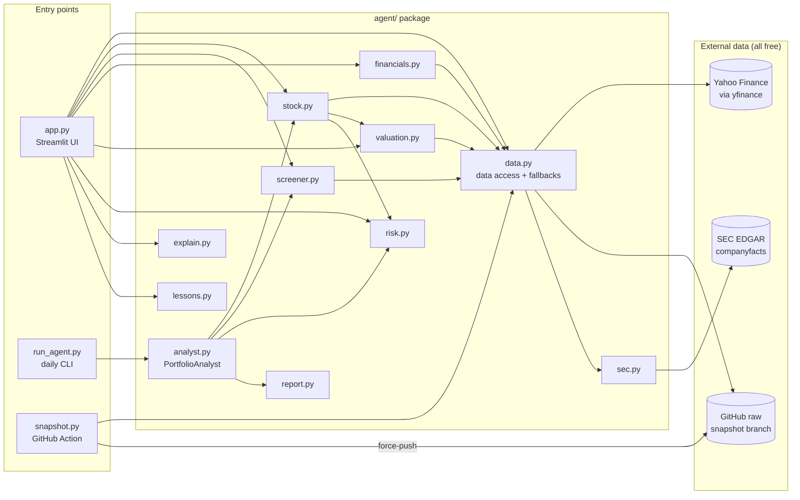
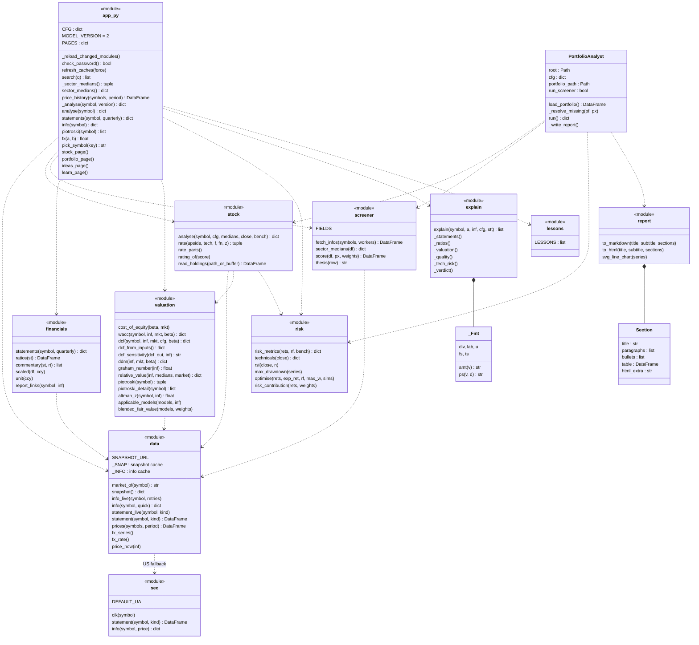
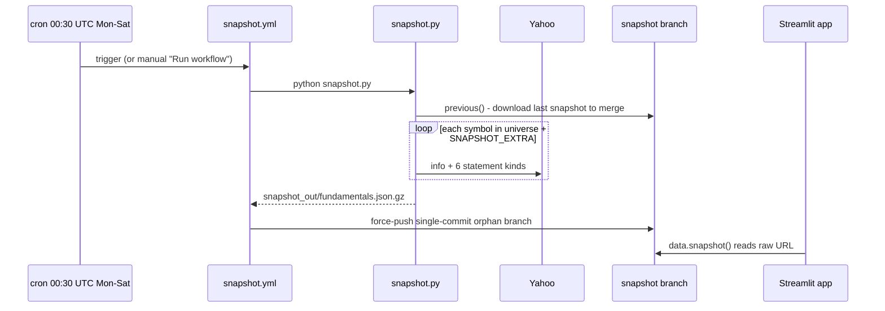
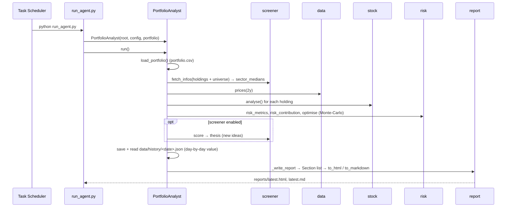
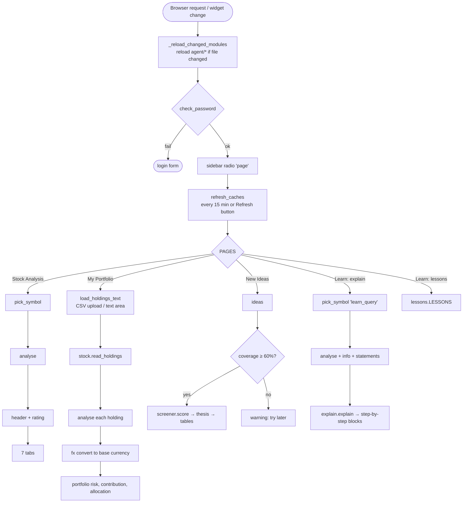
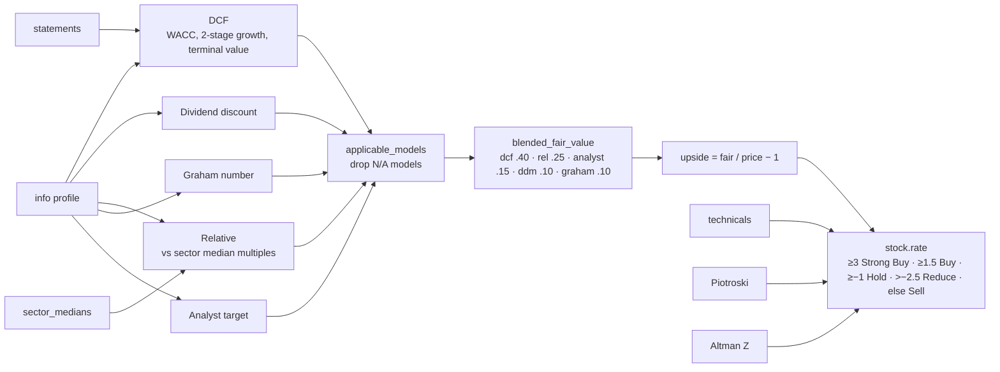

# Architecture & Debugging Guide

Technical reference for the AI Portfolio Analyst (Streamlit web app + daily CLI agent).
Diagrams use [Mermaid](https://mermaid.js.org/) and render directly on GitHub.

---

## 1. Big picture

There are **three entry points** sharing one `agent/` package:

| Entry point | Runs where | Purpose |
|---|---|---|
| `app.py` | Streamlit Community Cloud (or `streamlit run app.py`) | Web UI: Stock Analysis, My Portfolio, New Ideas, Learn |
| `run_agent.py` | Your PC (Windows scheduled task) | Daily portfolio report → `reports/latest.html` / `.md` |
| `snapshot.py` | GitHub Actions (`.github/workflows/snapshot.yml`) | Daily fundamentals snapshot → `snapshot` branch |



---

## 2. Module / class diagram

Most of the code is **plain modules of functions** (shown as `<<module>>`). The real Python classes are
`PortfolioAnalyst` (analyst.py), `Section` (report.py, a dataclass) and `_Fmt` (explain.py).



### Key data structure: the analysis dict

`stock.analyse()` returns one flat `dict` used by every page. The most important keys:

| Key | Meaning |
|---|---|
| `symbol`, `name`, `sector`, `market`, `ccy` | identity |
| `price`, `chg_1d`, `fair`, `upside` | headline numbers |
| `rating`, `score`, `why` | analyst verdict (from `stock.rate`) |
| `dcf`, `ddm`, `rel` | full model working (dicts incl. `growth_cap`, `wacc`, projected cash flows …) |
| `m_dcf`, `m_ddm`, `m_relative`, `m_graham`, `m_analyst_target` | each model's value |
| `f_score`, `f_n`, `z` | Piotroski and Altman Z |
| `t_*` / `r_*` | technicals (RSI, MACD, DMAs) / risk metrics (beta, Sharpe, drawdown) |
| `partial`, `source` | added by `app._analyse`: Yahoo throttled? data from SEC? |

---

## 3. Sequence diagrams

### 3.1 Searching a stock (Stock Analysis page)

```mermaid
sequenceDiagram
    actor U as User
    participant UI as app.py (stock_page)
    participant C as st.cache_data
    participant ST as stock.analyse
    participant SC as screener
    participant V as valuation
    participant R as risk
    participant D as data

    U->>UI: types "Microsoft"
    UI->>UI: pick_symbol() → search() → "MSFT"
    UI->>UI: analyse("MSFT")
    UI->>C: _analyse("MSFT", MODEL_VERSION)
    alt cached (< 15 min)
        C-->>UI: analysis dict
    else not cached
        C->>D: price_history(("MSFT","^GSPC"), "2y") → yf.download
        C->>SC: sector_medians() [cached 24h]
        Note over SC,D: first run of the day: fetch_infos(~75 stocks, quick=True)
        C->>D: info("MSFT") (see 3.2)
        C->>ST: analyse(symbol, CFG, medians, close, bench)
        ST->>R: technicals(close), risk_metrics(rets, rf, bench)
        ST->>V: dcf(), ddm(), relative_value(), graham_number()
        V->>D: statement("MSFT", "cashflow" / "balance_sheet" / ...)
        ST->>V: applicable_models() → blended_fair_value()
        ST->>V: piotroski(), altman_z()
        ST->>ST: rate(upside, tech, f, fn, z)
        ST-->>C: analysis dict (+ partial / source flags)
    end
    UI->>UI: partial → warning, hide fair value; SEC → info banner
    UI->>U: header metrics + 7 tabs
    U->>UI: opens "Annual Reports" tab
    UI->>D: statements() → financials.statements → data.statement
    UI->>U: tables, ratios, commentary
```

### 3.2 Data fallback chain (`data.info` / `data.statement`)

This is where most "slow" or "missing data" issues come from.

```mermaid
sequenceDiagram
    participant Caller
    participant D as data.info(symbol)
    participant M as _INFO memory cache
    participant SN as snapshot (GitHub raw)
    participant Y as Yahoo get_info
    participant SEC as sec.info (EDGAR)
    participant F as Yahoo fast_info

    Caller->>D: info("MSFT")
    D->>M: hit and not expired?
    alt hit (TTL 24h full / 1h SEC / 5m partial)
        M-->>Caller: profile
    else miss
        D->>SN: _snap(symbol)
        alt in snapshot and < 4 days old
            SN-->>D: profile
        else not in snapshot
            D->>Y: info_live (tries at 0s, +1.5s, +4s; quick=True → 1 try)
            alt Yahoo OK
                Y-->>D: profile
            else throttled and US stock
                D->>SEC: sec.info(symbol, price) → _source = "SEC EDGAR"
            end
            opt still nothing
                D->>F: fast_info → minimal profile, _partial = True
            end
        end
        D->>M: store with TTL by quality
        D-->>Caller: profile
    end
```

`data.statement(symbol, kind)` follows the same order: memory → snapshot → Yahoo (2 tries) →
`sec.statement` (US, annual only) → empty frame (cached 5 min).
The snapshot itself is re-read every 3 h (every 5 min while it is missing).

### 3.3 Daily snapshot (GitHub Actions)



### 3.4 Daily CLI report (`run_agent.py`)



---

## 4. Flow of each page



### How the fair value and rating are produced



---

## 5. Caching layers (important when debugging)

| Layer | Where | TTL | Cleared by |
|---|---|---|---|
| `_analyse`, `price_history` (`st.cache_data`) | app.py | 15 min | `refresh_caches()` (every 15 min / Refresh button); per symbol if partial or SEC |
| `statements`, `_info`, `piotroski` (`st.cache_data`) | app.py | 24 h | `_info` cleared when partial or SEC |
| `_sector_medians`, `_ideas` (`st.cache_data`) | app.py | 24 h | not kept when coverage < 60 % |
| `fx` (`st.cache_data`) | app.py | 1 h | `refresh_caches()` |
| `_INFO` dict | data.py | 24 h / 1 h (SEC) / 5 min (partial) | process restart, `data.info.cache_clear()` |
| statement memory cache | data.py | 24 h (empty: 5 min) | `data.statement.cache_clear()` |
| `_SNAP` | data.py | 3 h (5 min if missing) | process restart |
| `data._ticker` (lru_cache) | data.py | – | `refresh_caches()` |

> `st.cache_data` only notices changes to the **decorated function's own source**. If you change a model in
> `agent/` and old results still show, bump `MODEL_VERSION` in `app.py`.

---

## 6. Debugging guide — which file to check

| Symptom | Start here | Then check |
|---|---|---|
| Page is slow / spinner forever | `data.info`, `data.info_live`, `data.statement_live` (retry sleeps) | `app._sector_medians`, `screener.fetch_infos`, snapshot availability |
| "Yahoo is rate-limiting" warning | `data.info` fallback chain | Does the `snapshot` branch exist? Did the Action succeed? |
| Sector "–", no P/E, no fair value | `data._fast_info` (`_partial=True`) | `app.analyse` partial handling |
| Blue "SEC filings" banner | `sec.info`, `sec.statement` | `SEC_USER_AGENT` secret, `sec._get` (403s) |
| Wrong / odd fair value | `valuation.dcf`, `valuation.wacc` | `applicable_models`, `blended_fair_value`, `config.json` → `dcf`, `valuation_weights` |
| Relative value missing | `valuation.relative_value` | `screener.sector_medians`, `app._sector_medians` coverage |
| Rating looks wrong | `stock.rate_parts`, `stock.rating_of` | inputs `upside`, `t_*`, `f_score`, `z` |
| Piotroski / Altman blank | `valuation.piotroski_explained`, `valuation.altman_components` | `data.statement` (needs 2 years of statements) |
| Annual Reports tab empty | `financials.statements`, `financials._extract` | row names in `INCOME` / `BALANCE` / `CASHFLOW`; `sec.py` row mapping |
| Ratios / commentary wrong | `financials.ratios`, `financials.commentary` | – |
| RSI / MACD / beta wrong | `risk.technicals`, `risk.risk_metrics` | `app.price_history` / `data.prices` |
| Portfolio page error | `app.portfolio_page`, `stock.read_holdings` | CSV columns `symbol,quantity,avg_cost,broker`; `data.fx_series` |
| New Ideas empty / warning | `app._ideas`, `screener.score` | `config.json` → `screener.universe`, `weights` |
| Learn tab KeyError | `explain._valuation` and siblings | stale cache → bump `MODEL_VERSION` |
| Search finds nothing | `app.search` | Yahoo search endpoint; type the ticker with `.NS` / `.BO` |
| Change not visible after push | `app._reload_changed_modules` | Streamlit → Manage app → Reboot app |
| Daily report missing | `run_agent.py`, `PortfolioAnalyst.run` | Task Scheduler, `portfolio.csv`, `reports/` |
| Snapshot Action failed | `snapshot.py`, `.github/workflows/snapshot.yml` | Actions log; `contents: write` permission |

### Practical debugging techniques

1. **Run locally** with full tracebacks:
   ```powershell
   cd C:\Users\z004h8pf\PortfolioAnalystAgent
   .\.venv\Scripts\python.exe -m streamlit run app.py
   ```
2. **Call a model directly** without the UI (fastest way to inspect numbers):
   ```powershell
   .\.venv\Scripts\python.exe -c "import json; from agent import data, stock; cfg=json.load(open('config.json')); px=data.prices(['MSFT','^GSPC'],'2y'); a=stock.analyse('MSFT',cfg,{},px['MSFT'],px['^GSPC']); print(a['fair'], a['rating'], a['dcf']['wacc'])"
   ```
3. **See which data source was used**: `data.info('MSFT').get('_source')` (`None` = Yahoo or snapshot,
   `"SEC EDGAR"` = SEC fallback) and `.get('_partial')` (`True` = throttled, minimal data).
4. **Force data sources** with environment variables:
   - `PA_NO_SNAPSHOT=1` – ignore the snapshot (test live Yahoo / fallbacks)
   - `SNAPSHOT_FILE=path\to\fundamentals.json.gz` – use a local snapshot
   - `SNAPSHOT_URL=...` – alternate snapshot location
   - `SEC_USER_AGENT="Name email@domain"` – SEC identity
5. **Breakpoints in VS Code**: add a launch configuration with `"module": "streamlit"` and
   `"args": ["run", "app.py"]`, then set breakpoints in `agent/*.py`.
6. **Streamlit Cloud logs**: *Manage app* (bottom right) shows the full, un-redacted traceback.
7. **Headless UI test**:
   ```python
   from streamlit.testing.v1 import AppTest
   at = AppTest.from_file("app.py", default_timeout=300); at.run()
   at.text_input(key="query").set_value("TCS.NS").run()
   print(at.exception, [m.value for m in at.metric])
   ```
